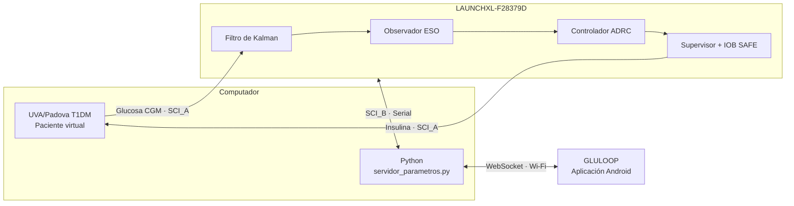

# GLULOOP-HIL

### Plataforma de simulación Hardware-in-the-Loop para validación de estrategias de control en páncreas artificial

<p align="center">
  <strong>Trabajo de grado · Ingeniería Electrónica</strong><br>
  Universidad Industrial de Santander · Bucaramanga, Colombia · 2026
</p>

<p align="center">
  
  
  
  
  
  
</p>

| | |
|---|---|
| **Autores** | Leonel Ricardo Araque Carreño · Paula Dayana Torres Mejía |
| **Director** | José Jorge Carreño Zagarra, Ph. D. |
| **Institución** | Universidad Industrial de Santander |
| **Programa** | Ingeniería Electrónica |
| **Año** | 2026 |

> [!IMPORTANT]
> Este proyecto fue desarrollado exclusivamente con fines académicos y de investigación. No constituye un dispositivo médico y no debe utilizarse para administrar insulina ni para tomar decisiones relacionadas con el tratamiento de personas con diabetes.

---

## Tabla de contenido

1. [Sobre el proyecto](#sobre-el-proyecto)
2. [Arquitectura de la plataforma](#arquitectura-de-la-plataforma)
3. [Estrategias de control](#estrategias-de-control)
4. [Escenarios experimentales](#escenarios-experimentales)
5. [Aplicación GLULOOP](#aplicación-gluloop)
6. [Resultados y validación](#resultados-y-validación)
7. [Estructura del repositorio](#estructura-del-repositorio)
8. [Tecnologías utilizadas](#tecnologías-utilizadas)
9. [Reproducción de los experimentos](#reproducción-de-los-experimentos)
10. [Documentación](#documentación)
11. [Limitaciones](#limitaciones)
12. [Estado del proyecto](#estado-del-proyecto)
13. [Cómo citar](#cómo-citar)
14. [Licencia y uso](#licencia-y-uso)

---

## Sobre el proyecto

**GLULOOP-HIL** es una plataforma experimental desarrollada para implementar y validar estrategias de control orientadas a sistemas de páncreas artificial mediante simulaciones y pruebas **Hardware-in-the-Loop (HIL)**.

El proyecto utiliza el simulador **UVA/Padova T1DM** para representar la dinámica glucosa-insulina de pacientes virtuales con diabetes mellitus tipo 1.

La estrategia principal desarrollada corresponde al **Control por Rechazo Activo de Perturbaciones (ADRC)**, complementado con mecanismos de estimación, supervisión y restricción de la administración de insulina.

Adicionalmente, se implementó un controlador **proporcional-integral-derivativo (PID)** como estrategia de comparación.

La plataforma integra:

- Simulación fisiológica mediante UVA/Padova T1DM.
- Identificación de modelos simplificados de la dinámica glucosa-insulina.
- Implementación de controladores ADRC y PID en MATLAB/Simulink.
- Procesamiento de la señal CGM mediante un filtro de Kalman.
- Estimación de estados y perturbaciones mediante un observador de estado extendido (ESO).
- Mecanismos de supervisión y restricción de insulina.
- Ejecución del controlador ADRC sobre hardware físico.
- Comunicación serial y WebSocket.
- Aplicación Android GLULOOP para visualización y configuración.

La implementación HIL utiliza una tarjeta **Texas Instruments LAUNCHXL-F28379D**, encargada de ejecutar el algoritmo de control, mientras que el simulador UVA/Padova representa el comportamiento fisiológico del paciente virtual.

---

## Arquitectura de la plataforma

La plataforma HIL integra el simulador fisiológico, el controlador implementado en hardware y la aplicación móvil GLULOOP.



El simulador proporciona la información glucémica del paciente virtual y recibe la señal de insulina calculada por el controlador.

La tarjeta ejecuta el procesamiento de señales, la estimación de estados, la ley de control ADRC y los mecanismos de supervisión.

De forma paralela, el programa de Python permite intercambiar información con GLULOOP mediante WebSocket.

La documentación de esta implementación se encuentra en [HIL](HIL/).

---

## Estrategias de control

### Controlador ADRC

El controlador ADRC constituye la estrategia principal desarrollada en el proyecto.

Su implementación comprende:

- **Filtro de Kalman:** procesamiento de la señal de glucosa procedente del CGM.
- **Observador de estado extendido (ESO):** estimación de los estados del sistema y de la perturbación total.
- **Ley de control ADRC:** cálculo de la acción de control para regular la concentración de glucosa.
- **Supervisor:** modificación de la acción de control de acuerdo con las condiciones estimadas del sistema.
- **Estimación de IOB:** cálculo de la insulina activa estimada.
- **IOB SAFE:** aplicación de restricciones relacionadas con la insulina activa.
- **Saturaciones:** limitación de la administración de insulina dentro de los valores establecidos.

Para apoyar el diseño del controlador, se identificaron modelos simplificados de segundo orden con retardo, denominados **SOPTD (Second-Order Plus Time Delay)**, a partir de ensayos en lazo abierto.

### Controlador PID

Se implementó un controlador PID como estrategia de comparación para evaluar el desempeño del ADRC.

El controlador se integró en el entorno de simulación UVA/Padova para realizar pruebas bajo condiciones experimentales comparables.

### Archivos de implementación

Los subsistemas de control se encuentran en:

[Controller/Simulink](Controller/Simulink/)

Estos archivos corresponden a implementaciones de los controladores y no incluyen el simulador UVA/Padova completo.

Para ejecutar las simulaciones es necesario integrar los subsistemas dentro de una instalación autorizada del simulador.

---

## Escenarios experimentales

La evaluación mediante simulación comprende los **10 pacientes adultos virtuales** del simulador UVA/Padova T1DM.

### Identificación en lazo abierto

Se realizaron ensayos de identificación para obtener modelos simplificados de la dinámica glucosa-insulina.

Los ensayos se desarrollaron durante 24 horas simuladas, sin ingesta de alimentos y aplicando un bolo de insulina de 1 U en el minuto 100.

### Escenarios de alimentación

Se consideraron dos escenarios diarios de ingesta de carbohidratos:

| Escenario | 06:00 | 13:00 | 19:00 | Total |
|:---|---:|---:|---:|---:|
| **100 gCH/día** | 30 gCH | 40 gCH | 30 gCH | 100 gCH |
| **130 gCH/día** | 40 gCH | 50 gCH | 40 gCH | 130 gCH |

Cada ensayo comprende **24 horas simuladas**.

Se realizaron pruebas con los diez pacientes adultos en ambos escenarios, obteniendo un total de **20 simulaciones** para la evaluación de la estrategia ADRC.

La configuración experimental se documenta en [Experiments](Experiments/).

---

## Aplicación GLULOOP

**GLULOOP** es una aplicación Android desarrollada como interfaz de visualización y configuración de la plataforma HIL.

La aplicación permite visualizar variables relacionadas con el funcionamiento del sistema, incluyendo:

- Concentración de glucosa.
- Administración de insulina.
- Insulina activa estimada (IOB).
- Estado de conexión.
- Evolución temporal de las señales.

También dispone de una interfaz para introducir parámetros de configuración utilizados en la plataforma experimental.

### Código fuente e instalación

La carpeta [Gluloop](Gluloop/) contiene los recursos asociados al desarrollo de la aplicación.

Allí se encuentra la implementación para Android Studio y, cuando está disponible, el archivo APK para instalar la aplicación en dispositivos Android compatibles.

La aplicación requiere la infraestructura de comunicación correspondiente para visualizar información procedente de la plataforma HIL.

---

## Resultados y validación

La validación del proyecto comprende tres etapas principales.

### 1. Identificación de modelos

Se realizaron ensayos en lazo abierto para caracterizar la respuesta glucémica de los pacientes virtuales ante la administración de insulina.

A partir de estos ensayos se obtuvieron modelos SOPTD simplificados para apoyar el diseño y la parametrización del controlador.

Los resultados se encuentran en:

[Results/Identification](Results/Identification/)

### 2. Simulación de las estrategias de control

La evaluación del ADRC comprende los diez pacientes adultos bajo los escenarios de 100 y 130 gCH/día.

Se analizaron variables como la concentración de glucosa, la administración de insulina y la acción de control.

Entre los indicadores de desempeño se encuentran:

| Indicador | Descripción |
|---|---|
| **TIR** | Porcentaje de tiempo con glucosa entre 70 y 180 mg/dL. |
| **TAR** | Porcentaje de tiempo con glucosa superior a 180 mg/dL. |
| **TBR** | Porcentaje de tiempo con glucosa inferior a 70 mg/dL. |
| **RMSE** | Raíz del error cuadrático medio. |
| **IAE** | Integral del valor absoluto del error. |
| **ISE** | Integral del error cuadrático. |
| **ITAE** | Integral del error absoluto ponderado por el tiempo. |
| **Esfuerzo de control** | Indicador asociado a la magnitud de la acción de control. |

También se analizaron los valores mínimos y máximos de glucosa, así como los resultados de la comparación con la estrategia PID.

Los datos, gráficas y métricas se encuentran en:

[Results/Simulation](Results/Simulation/)

### 3. Validación Hardware-in-the-Loop

La validación HIL se realizó ejecutando el controlador ADRC en la tarjeta Texas Instruments LAUNCHXL-F28379D.

El simulador UVA/Padova continuó representando la dinámica fisiológica del paciente virtual, mientras que la tarjeta calculó la acción de control.

Los ensayos HIL se realizaron con pacientes seleccionados y permitieron registrar las variables del sistema durante la ejecución sobre hardware.

En esta configuración, los ensayos de 24 horas simuladas se ejecutaron durante **24 horas de tiempo real**.

Los resultados y registros de la plataforma se encuentran en:

[Results/HIL](Results/HIL/)

---

## Estructura del repositorio

```text
GLULOOP-HIL/
│
├── Analysis/          # Procesamiento de datos y métricas
├── Controller/        # Controladores ADRC y PID
├── Docs/              # Documentación técnica, tesis y anexos
├── Experiments/       # Configuración experimental
├── Gluloop/           # Aplicación Android
├── HIL/               # Implementación en hardware y comunicación
├── Results/           # Resultados experimentales
└── README.md
```

### Descripción de las carpetas

| Carpeta | Contenido |
|---|---|
| [Analysis](Analysis/) | Scripts para procesar señales, generar gráficas y calcular métricas. |
| [Controller](Controller/) | Subsistemas ADRC y PID desarrollados en MATLAB/Simulink. |
| [Docs](Docs/) | Documentación académica y técnica, incluidos los anexos. |
| [Experiments](Experiments/) | Configuración de los escenarios de identificación y simulación. |
| [Gluloop](Gluloop/) | Código fuente y recursos de la aplicación Android. |
| [HIL](HIL/) | Implementación del controlador en hardware y comunicación con GLULOOP. |
| [Results](Results/) | Datos, gráficas y resultados de simulación y validación HIL. |

Cada sección dispone de documentación específica para facilitar la consulta de sus archivos.

---

## Tecnologías utilizadas

### Software

| Herramienta | Aplicación |
|---|---|
| MATLAB/Simulink | Modelado, implementación y simulación de controladores. |
| UVA/Padova T1DM Simulator v3.2.1 | Simulación fisiológica de pacientes virtuales con diabetes tipo 1. |
| System Identification Toolbox | Apoyo al proceso de identificación de modelos. |
| Herramientas de soporte TI C2000 | Implementación del controlador en la tarjeta de desarrollo. |
| Python | Comunicación entre hardware y aplicación Android. |
| Android Studio | Desarrollo de la aplicación GLULOOP. |
| Kotlin | Implementación de la aplicación Android. |

### Hardware

- **Texas Instruments LAUNCHXL-F28379D**, basada en el microcontrolador TMS320F28379D.
- Computador para ejecutar MATLAB/Simulink, UVA/Padova y el programa de comunicación.
- Dispositivo Android compatible con GLULOOP.
- Interfaces de comunicación serial y conexión de red.

---

## Reproducción de los experimentos

### Requisitos previos

Para reproducir las simulaciones y la implementación HIL se requiere disponer de las herramientas de software, hardware y dependencias correspondientes.

En particular, el simulador **UVA/Padova T1DM no está incluido en este repositorio**.

Su utilización requiere acceso autorizado y el cumplimiento de las condiciones de licencia establecidas por sus desarrolladores.

La información sobre el simulador y las herramientas utilizadas se encuentra en [Docs](Docs/).

### Simulaciones en UVA/Padova

1. Disponer de una instalación autorizada de UVA/Padova T1DM.
2. Consultar los subsistemas disponibles en [Controller/Simulink](Controller/Simulink/).
3. Integrar el controlador ADRC o PID dentro del entorno del simulador.
4. Inicializar los parámetros correspondientes al controlador y al paciente virtual.
5. Configurar el escenario experimental.
6. Ejecutar la simulación y registrar las señales necesarias.

### Implementación HIL

1. Disponer de la tarjeta LAUNCHXL-F28379D y de las herramientas de desarrollo correspondientes.
2. Consultar el modelo de Simulink disponible en [HIL/Embedded](HIL/Embedded/).
3. Configurar e implementar el controlador en la tarjeta.
4. Establecer la comunicación serial con el simulador UVA/Padova.
5. Ejecutar el ensayo HIL.

### Comunicación con GLULOOP

El programa de comunicación se encuentra en:

[HIL/Communication/Python/servidor_parametros.py](HIL/Communication/Python/servidor_parametros.py)

Para establecer la comunicación se requiere configurar el puerto serial y los parámetros de red correspondientes al equipo utilizado.

La documentación de las interfaces y el esquema de comunicación se encuentra en:

[HIL/Communication/Protocols](HIL/Communication/Protocols/)

### Análisis de resultados

Los scripts empleados para procesar las señales, calcular las métricas y generar las gráficas se encuentran en:

[Analysis](Analysis/)

Los resultados de los experimentos se encuentran organizados en:

[Results](Results/)

---

## Documentación

La carpeta [Docs](Docs/) reúne los documentos académicos y técnicos relacionados con el desarrollo del proyecto.

Incluye el material complementario del trabajo de grado y los recursos necesarios para consultar las herramientas utilizadas.

### Simulador UVA/Padova

Los siguientes enlaces proporcionan información relacionada con el simulador:

- [TEG Virginia](https://tegvirginia.com/)
- [The UVA/PADOVA Type 1 Diabetes Simulator: New Features](https://doi.org/10.1177/1932296813514502)
- [UVAPadovaAPI](https://github.com/NeuroDiab/UVAPadovaAPI)

El repositorio no distribuye el simulador original ni sus componentes propietarios.

---

## Limitaciones

- La evaluación fisiológica se realiza *in silico*, utilizando pacientes virtuales adultos.
- La validación HIL comprende pacientes seleccionados de los evaluados mediante simulación.
- Los modelos SOPTD utilizados son aproximaciones simplificadas de la dinámica glucosa-insulina.
- La implementación requiere acceso autorizado al simulador UVA/Padova.
- Los parámetros y límites experimentales de control no deben interpretarse como recomendaciones clínicas.
- La aplicación GLULOOP y la plataforma HIL corresponden a prototipos experimentales.

La discusión detallada de los alcances y limitaciones se presenta en el trabajo de grado.

---

## Estado del proyecto

**Finalizado — 2026**

Se completaron las actividades de desarrollo y validación experimental contempladas en el proyecto:

- Identificación de modelos simplificados para los pacientes virtuales.
- Diseño e implementación del controlador ADRC.
- Implementación del controlador PID para comparación.
- Evaluación mediante simulaciones en UVA/Padova.
- Integración del controlador ADRC en la plataforma HIL.
- Desarrollo de la aplicación Android GLULOOP.
- Implementación de los mecanismos de comunicación.
- Procesamiento y análisis de resultados.
- Organización de los archivos y la documentación del proyecto.

El repositorio reúne los componentes desarrollados y los resultados obtenidos durante el trabajo de grado.

---

## Cómo citar

Si utiliza este repositorio o los resultados del proyecto, puede citar el trabajo de grado de la siguiente manera:

```bibtex
@thesis{araque_torres_2026_gluloophil,
  author  = {Araque Carreño, Leonel Ricardo and Torres Mejía, Paula Dayana},
  title   = {Plataforma de simulación Hardware-in-the-Loop para validación de estrategias de control en páncreas artificial},
  school  = {Universidad Industrial de Santander},
  address = {Bucaramanga, Colombia},
  year    = {2026},
  type    = {Trabajo de grado},
  note    = {Director: José Jorge Carreño Zagarra}
}
```

Los datos bibliográficos pueden complementarse con el enlace institucional cuando el documento se encuentre publicado oficialmente.

---

## Licencia y uso

El código, la documentación y los resultados desarrollados por los autores están sujetos a las condiciones de uso y distribución que se establezcan para el repositorio.

Los componentes de terceros conservan sus respectivas licencias.

En particular, el simulador UVA/Padova T1DM no forma parte de este repositorio y debe obtenerse mediante los canales autorizados.

---

## Aviso importante

Este repositorio corresponde a una plataforma experimental desarrollada con fines académicos y de investigación.

**GLULOOP-HIL no es un dispositivo médico, no ha sido diseñado para uso clínico y no debe utilizarse para administrar insulina ni para tomar decisiones relacionadas con el tratamiento de personas con diabetes.**
