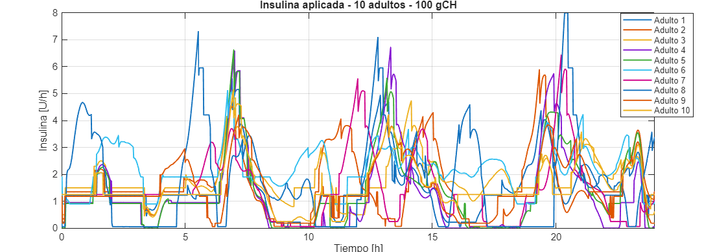
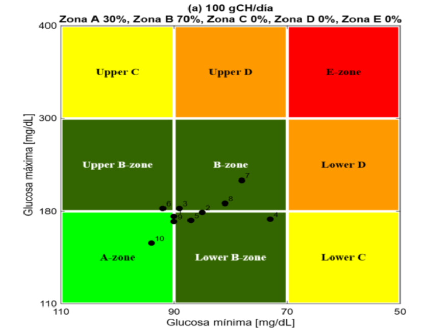
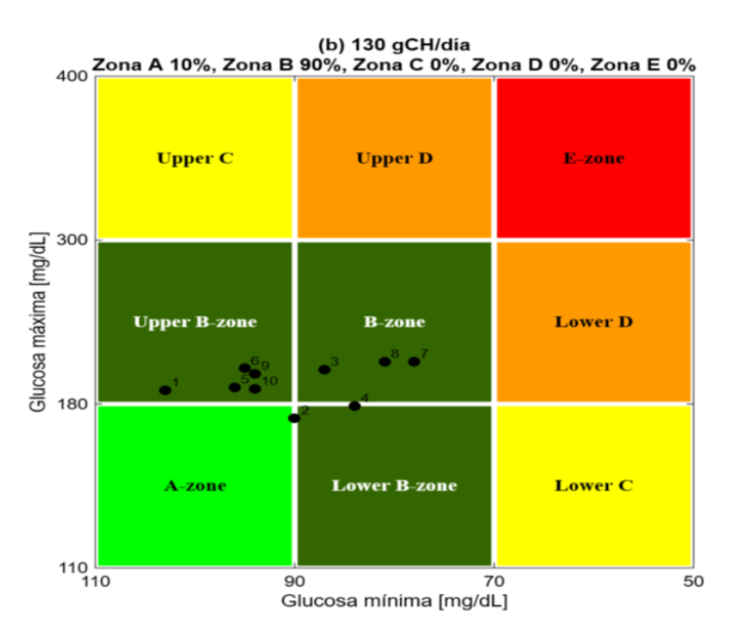

# Resumen de resultados de simulación

Esta sección reúne los principales resultados obtenidos durante la evaluación de la estrategia de control ADRC sobre los **10 pacientes adultos virtuales** del simulador UVA/Padova T1DM.

Se analizaron dos escenarios experimentales de alimentación:

- **100 gCH/día:** 30 gCH a las 06:00, 40 gCH a las 13:00 y 30 gCH a las 19:00.
- **130 gCH/día:** 40 gCH a las 06:00, 50 gCH a las 13:00 y 40 gCH a las 19:00.

Las figuras presentan de forma conjunta las respuestas de los pacientes y complementan los resultados individuales disponibles en las carpetas de cada escenario.

---

## Escenario de 100 gCH/día

### Respuesta de glucosa

La siguiente figura presenta la evolución de la concentración de glucosa de los diez pacientes durante el escenario de **100 gCH/día**.

  

Las curvas permiten comparar la respuesta glucémica de los pacientes ante las tres ingestas de carbohidratos y observar las diferencias individuales durante las 24 horas simuladas.

### Resultados complementarios

  

Esta figura complementa la evaluación conjunta del escenario de 100 gCH/día. Su interpretación detallada se presenta en el documento del trabajo de grado.

### Administración de insulina

La siguiente figura presenta la evolución de la administración de insulina durante el escenario de **100 gCH/día**.

  

Las curvas permiten comparar las acciones de administración de insulina calculadas para los pacientes virtuales durante el ensayo, incluyendo la respuesta del controlador ante las ingestas de carbohidratos.

### Análisis de variabilidad del control glucémico (CVGA)

El análisis CVGA relaciona los valores mínimos y máximos de glucosa registrados para cada paciente y los representa en una cuadrícula de clasificación.

  

Cada punto corresponde a un paciente virtual. Las zonas A y B representan las regiones de mejor desempeño dentro de la clasificación CVGA, mientras que las zonas C, D y E corresponden a regiones de mayor desviación glucémica.

---

## Escenario de 130 gCH/día

### Respuesta de glucosa

La siguiente figura presenta la evolución de la concentración de glucosa de los diez pacientes durante el escenario de **130 gCH/día**.

  

La representación conjunta permite observar las diferencias entre pacientes y analizar el comportamiento de la estrategia de control ante el incremento de la ingesta diaria de carbohidratos.

### Resultados complementarios

  

Esta figura complementa los resultados del escenario de 130 gCH/día. Su análisis detallado se encuentra en el documento del trabajo de grado.

### Administración de insulina

La siguiente figura presenta la evolución de la administración de insulina durante el escenario de **130 gCH/día**.

  

Las curvas permiten examinar la respuesta del controlador ante las ingestas de carbohidratos y comparar la administración de insulina entre los pacientes virtuales.

### Análisis de variabilidad del control glucémico (CVGA)

La siguiente figura presenta la clasificación CVGA correspondiente al escenario de **130 gCH/día**.

  

Los resultados muestran la siguiente distribución:

| Zona CVGA | Pacientes | Porcentaje |
|---|---:|---:|
| A | 1 | 10 % |
| B | 9 | 90 % |
| C | 0 | 0 % |
| D | 0 | 0 % |
| E | 0 | 0 % |
| **Total** | **10** | **100 %** |

Los diez pacientes se ubicaron en las zonas A y B, sin registros en las zonas C, D o E. Esta distribución indica un desempeño favorable de la estrategia ADRC según los criterios de clasificación CVGA utilizados.

---

## Resultados individuales

Los datos, gráficas y métricas correspondientes a cada paciente se encuentran organizados en las carpetas de los respectivos escenarios:

- [100gCH](../100g/)
- [130gCH](../130g/)

Cada escenario contiene los resultados individuales de los pacientes evaluados, organizados en las subcarpetas correspondientes a **datos, gráficas y métricas**.

Para conocer el procedimiento de procesamiento de señales y cálculo de indicadores, consulte la carpeta [Analysis](../../../Analysis/).
